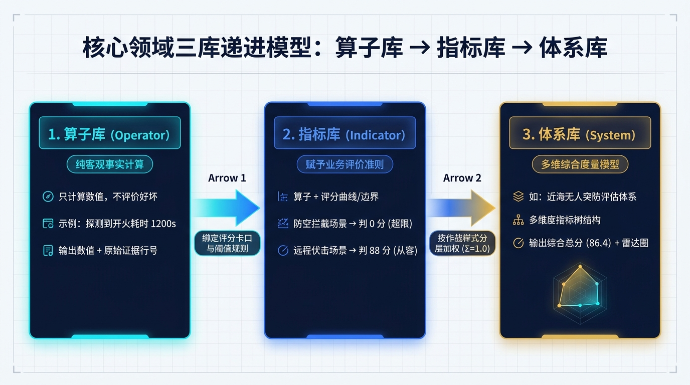
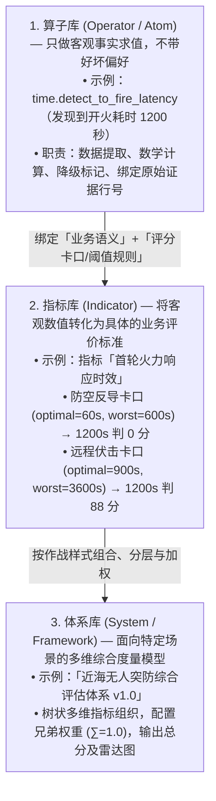
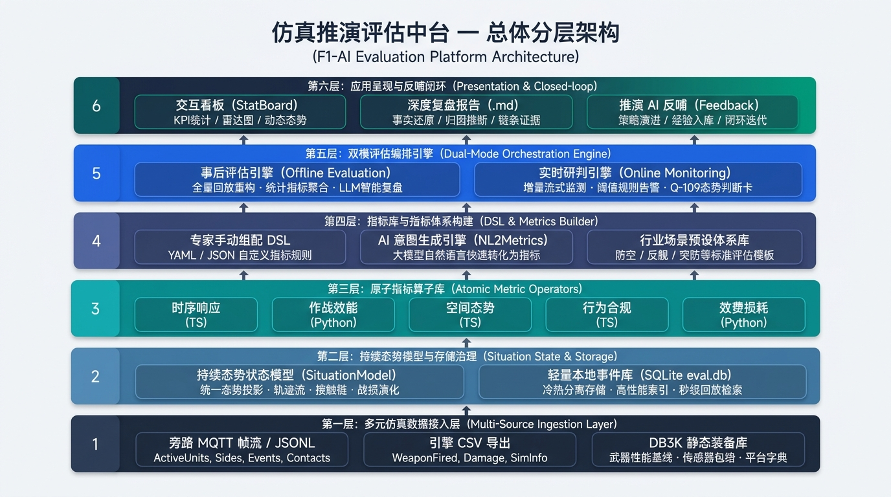
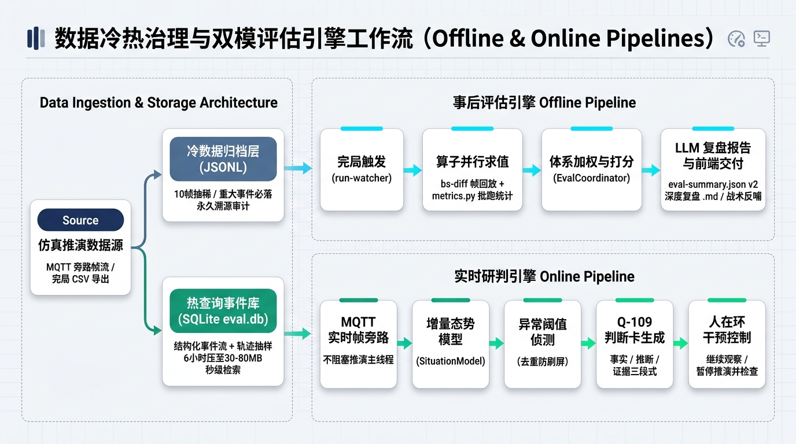
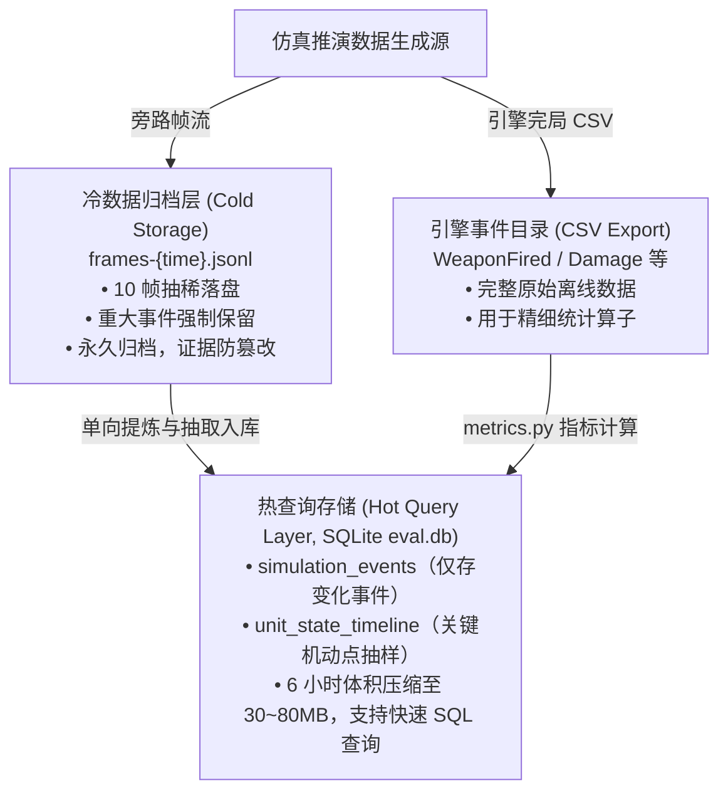
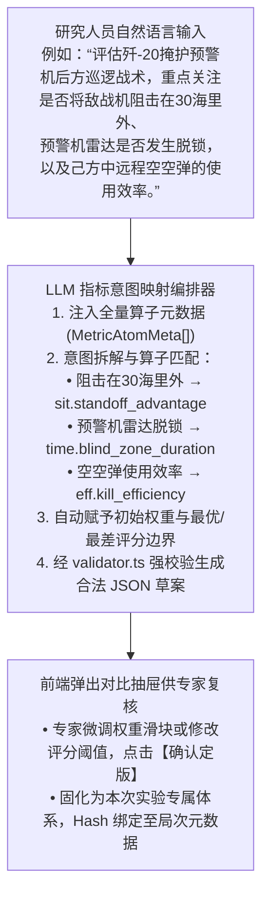
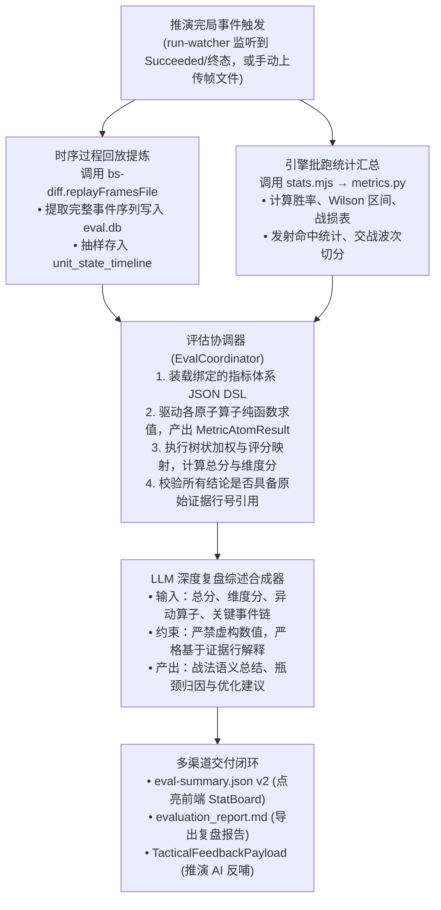
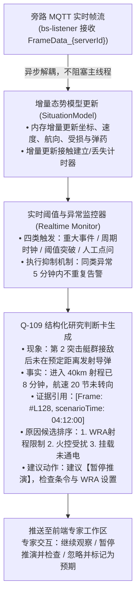
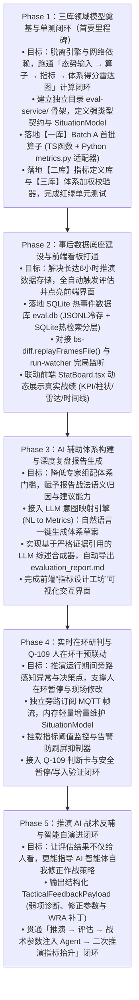

# 仿真推演评估中台（实时研判与事后评估）总体设计方案

> **文件标识**：`F1-AI-ARCH-EVAL-202611`  
> **修订版本**：v1.1（确立“先立三库领域模型”路线及 TS+Python 混合技术栈决策）  
> **编制状态**：总体架构设计评审稿（未施工）  
> **面向对象**：推演想定制作人员、作战实验研究员、仿真平台研发团队  
> **关联依据**：
> - `Q-109：实时推演研究与人在环干预模式`
> - `01-内置初版溯源与改造评估`
> - `demo-ui/proxy/` 既有代理网关、帧差分与守望者实现
> - `LabConsole/tools/metrics/metrics.py` 生产级效能计算实现

---

## 目录

- [一、背景与建设愿景](#一背景与建设愿景)
  - [1.1 现状与痛点剖析](#11-现状与痛点剖析)
  - [1.2 核心建设目标与定位](#12-核心建设目标与定位)
- [二、顶层架构、领域模型与技术选型](#二顶层架构领域模型与技术选型)
  - [2.1 核心领域分层：算子库 → 指标库 → 体系库](#21-核心领域分层算子库--指标库--体系库)
  - [2.2 整体系统架构图](#22-整体系统架构图)
  - [2.3 技术栈选型决策：TypeScript 主控 + Python 统计算子](#23-技术栈选型决策typescript-主控--python-统计算子)
  - [2.4 工程目录规划 (`eval-service/`)](#24-工程目录规划-eval-service)
- [三、多元数据接入与存储底座](#三多元数据接入与存储底座)
  - [3.1 数据源全景梳理](#31-数据源全景梳理)
  - [3.2 6小时长时推演存储治理：冷热分离架构](#32-6小时长时推演存储治理冷热分离架构)
  - [3.3 轻量时序事件数据库 Schema (`eval.db`)](#33-轻量时序事件数据库-schema-evaldb)
- [四、原子指标算子库（Metric Operator Library）](#四原子指标算子库metric-operator-library)
  - [4.1 算子统一接口规范](#41-算子统一接口规范)
  - [4.2 算子可行性分层与全景矩阵](#42-算子可行性分层与全景矩阵)
    - [4.2.1 ⏱ 时序与作战节奏类算子](#421--时序与作战节奏类算子)
    - [4.2.2 📊 作战效能与毁伤类算子](#422--作战效能与毁伤类算子)
    - [4.2.3 🗺 空间态势与阵位类算子](#423--空间态势与阵位类算子)
    - [4.2.4 🎯 规则与条令合规类算子](#424--规则与条令合规类算子)
    - [4.2.5 💰 效费比与资源消耗类算子](#425--效费比与资源消耗类算子)
- [五、指标库与体系库构建机制（Indicator & System Builder）](#五指标库与体系库构建机制indicator--system-builder)
  - [5.1 指标库（Indicator Definitions）与评分卡口](#51-指标库indicator-definitions与评分卡口)
  - [5.2 体系库（Indicator System JSON DSL）规范](#52-体系库indicator-system-json-dsl规范)
  - [5.3 专家手动组配与场景预设模板库](#53-专家手动组配与场景预设模板库)
  - [5.4 AI 辅助意图转换与指标生成（NL to Metrics）](#54-ai-辅助意图转换与指标生成nl-to-metrics)
- [六、双模评估引擎工作流设计](#六双模评估引擎工作流设计)
  - [6.1 事后评估引擎流水线（Offline Post-Run Pipeline）](#61-事后评估引擎流水线offline-post-run-pipeline)
  - [6.2 实时研判引擎流水线（Online Real-Time Pipeline）](#62-实时研判引擎流水线online-real-time-pipeline)
  - [6.3 统一持续态势模型（SituationModel）设计](#63-统一持续态势模型situationmodel设计)
- [七、产出层规范与推演 AI 反哺机制](#七产出层规范与推演-ai-反哺机制)
  - [7.1 前端交互看板兼容数据契约 (`eval-summary.json` v2)](#71-前端交互看板兼容数据契约-eval-summaryjson-v2)
  - [7.2 深度复盘报告模板 (`evaluation_report.md`)](#72-深度复盘报告模板-evaluation_reportmd)
  - [7.3 推演 AI 战术自演进反哺接口（Tactical Feedback Payload）](#73-推演-ai-战术自演进反哺接口tactical-feedback-payload)
- [八、分期实施路线图（先立三库，后接链路）](#八分期实施路线图先立三库后接链路)
- [九、关键设计准则与安全红线](#九关键设计准则与安全红线)

---

## 一、背景与建设愿景

### 1.1 现状与痛点剖析

在当前的 F1-AI 体系中，系统已经形成了较好的仿真控制、旁路态势订阅、事件差分以及基于蒙卡批跑的 CSV 统计能力：
1. `demo-ui/proxy/bs-listener.mjs` 支持旁路接收 MQTT 帧流并抽稀落盘（`frames-*.jsonl`）；
2. `demo-ui/proxy/bs-diff.mjs` 具备相邻帧对比提取新单元、单元机动、单元被毁、武器发射、目标发现与丢失等事件卡能力；
3. `LabConsole/tools/metrics/metrics.py` 具备成熟的 CSV 结果统计指标（成功率、Wilson 置信区间、战损明细、发射命中、交战周期、效费比等）；
4. `run-watcher.mjs` 建立了基于推演状态轮询与终态分类（Succeeded / Stopped / TimedOut / Failed）的自动通知机制。

但是，当前体系在**“评估能力”**上仍存在显著断层：
* **态势播报只能陈述事实，缺乏战术研判**：现有的 `bs-commentary.mjs` 仅扮演“解说员”角色，将事件卡压缩为口语播报。它不知道本次推演的研究意图，无法判断当前行动是否合理、为何久未发现目标、为何未开火、是否需要人工干预。
* **事后统计与态势时序割裂**：现有的 `metrics.py` 严重依赖推演结束后的 CSV 聚合导出，缺少与推演微观轨迹时序（单位空间机动、态势盲区、雷达接触持续性）的关联分析。
* **指标体系硬编码，无法按需配置**：不同作战样式（防空反导、近海突防、要地封锁）关注的指标完全不同，缺乏一套通用的“算子库”与“灵活组装的指标体系构建引擎”。

### 1.2 核心建设目标与定位

本方案旨在打造一个**独立的推演评估中台（Eval Platform）**，定位为**“算子全量提供、体系自由组配、计算双模复用、数据闭环反哺”**：
1. **全量指标算子库**：提供覆盖时序响应、交战效能、空间态势、行动合规、效费度量的全量原子算子。
2. **多源体系构建**：既支持研究人员通过可视化界面**手动组配**指标权重与评分卡口，也支持通过大模型（LLM）基于自然语言研究意图**AI 自动生成**指标体系。
3. **双模评估能力**：
   * **事后评估**：全量帧时序回放 + CSV 深度统计，自动产出综合评分雷达图、KPI 概览、过程溯源时间线与结构化深度复盘报告；
   * **实时研判**：旁路增量维护态势模型，基于算子阈值检测异常与决策点，输出 Q-109 结构化判断卡，支撑专家人在环暂停与修改干预。
4. **推演 AI 闭环反哺**：评估结果除呈现给人类专家外，还以标准数据契约反哺自主作战智能体（Agent），指导其战术策略的自演进。

---

## 二、顶层架构、领域模型与技术选型

### 2.1 核心领域分层：算子库 → 指标库 → 体系库

为了避免“业务评价标准”与“底层事实计算”耦合混乱，评估中台在领域模型上严格划分为三层递进关系，并作为独立工程优先构建：





### 2.2 整体系统架构图

中台以独立进程运行，不占用推演主进程（C# 引擎）和核心代理进程（`demo-ui/proxy`）的事件循环：

```mermaid
flowchart BT
    subgraph L1["第一层：多元仿真数据接入层"]
        direction LR
        D1["旁路 MQTT 帧流 / JSONL 归档\nActiveUnits / Sides / Events\n(抽稀容忍与长时推演容错)"]
        D2["引擎 CSV 导出 (EventCSV)\nWeaponFired / Damage /\nSimInfo / UnitPositions"]
        D3["静态装备参考 (DB3K)\n平台 / 雷达 / 武器基线\n(SQLite 只读网关)"]
    end

    subgraph L2["第二层：持续态势模型与存储治理"]
        direction LR
        S1["持续态势状态模型 (SituationModel)\n单位轨迹 Tracks / 接触链 Contacts /\n武器毁伤链 WeaponChain / 任务状态"]
        S2["本地轻量事件与时序存储 (SQLite eval.db)\nsimulation_events / unit_state_timeline /\nrun_metadata / evaluation_results"]
    end

    subgraph L3["第三层：原子指标算子库"]
        direction LR
        O1["时序响应\n(TS 纯函数)"]
        O2["作战效能\n(适配 metrics.py)"]
        O3["空间态势\n(TS 几何计算)"]
        O4["行为合规\n(TS 规则校验)"]
        O5["效费损耗\n(适配 metrics.py)"]
    end

    subgraph L4["第四层：指标库与体系库 (DSL & Builder)"]
        direction LR
        B1["专家手动组配 DSL\n算子拾取 / 卡口 / 权重配置"]
        B2["AI 意图生成引擎\n自然语言任务 → 算子映射"]
        B3["行业场景预设标准库\n海上突防 / 要地防空预设模板"]
    end

    subgraph L5["第五层：评估编排与推理引擎层"]
        direction LR
        E1["事后评估引擎 (Offline Engine)\n帧回放重构 (replayFramesFile) · 统计聚合 (metrics.py)\n加权体系评分 · LLM 深度复盘综述"]
        E2["实时研判引擎 (Online Engine)\n增量帧流差分驱动 · 阈值触发与去重监控\nQ-109 判断卡生成 · 人在环暂停/干预建议"]
    end

    subgraph L6["第六层：应用呈现与反哺闭环层"]
        direction LR
        P1["交互看板 (StatBoard)\nKPI / 柱状图 / 雷达图"]
        P2["结构化研判报告 (.md)\n事实 / 推断 / 证据三段式"]
        P3["推演 AI 战术反哺 (Feedback)\n弱项诊断 / 战术调优约束输入"]
    end

    L1 --> L2 --> L3 --> L4 --> L5 --> L6
```





### 2.3 技术栈选型决策：TypeScript 主控 + Python 统计算子

基于仓库既有代码资产与性能特性，确立以下混编架构决策，实现双向零重复造轮子：

| 层次 / 组件 | 选定技术栈 | 决策依据 |
|------------|-----------|---------|
| **中台框架与编排引擎** | **TypeScript (Node.js)** | 1. 100% 复用既有 `demo-ui/proxy/bs-diff.mjs` 中近千行防御性帧解析与事件提取代码；<br>2. 与 React/TS 前端共享全套指标体系与看板 Schema 接口，零反序列化偏差；<br>3. 异步事件驱动天然适合后续接入旁路实时 MQTT 态势流。 |
| **时序 / 空间 / 合规算子** | **TypeScript 纯函数** | 直接消费内存态势模型或 SQLite 事件流，处理耗时毫秒级，极易于用单元测试锁死。 |
| **复杂效能与统计算子** | **Python (`metrics.py`) 适配器** | 既有 `LabConsole/tools/metrics/metrics.py` 已通过生产验证（含 Pandas CSV 卫生核验、Wilson 95% 置信区间、60s 交战波次切分与效费计算）。通过独立子进程适配器直接调用其产出 JSON，绝不在 JS 中重写。 |
| **未来高阶运筹评估算法** | **Python 扩展脚本** | 保持开放接口，后续引入层次分析法 (AHP)、TOPSIS、神经网络打分等科研算法时，直接以独立 Python 插件形式挂载至算子库。 |

### 2.4 工程目录规划 (`eval-service/`)

中台部署在独立顶层目录 `d:\F1-AI\eval-service\`，做到与现存 `demo-ui/proxy` 物理隔离：

```text
eval-service/
├── package.json
├── tsconfig.json
├── src/
│   ├── core/                     # 标准领域契约与类型定义 (Context, Result, Schema)
│   │   ├── types.ts
│   │   ├── situation-model.ts    # 统一持续态势模型构造器
│   │   └── scoring-functions.ts  # 归一化评分卡口纯函数 (linear/step/smaller_is_better)
│   ├── operators/                # 【一库】原子指标算子库
│   │   ├── registry.ts           # 算子注册表与元信息检索
│   │   ├── time/                 # 时序响应算子 (first_detection, detect_to_fire_latency 等)
│   │   ├── effectiveness/        # 效能算子 (含 metrics-py-adapter.ts 适配器)
│   │   ├── situation/            # 空间态势算子 (standoff_advantage, arrival_delta 等)
│   │   └── compliance/           # 合规算子 (带优雅降级保护)
│   ├── indicators/               # 【二库】标准指标定义库 (算子 + 评价准则绑定)
│   │   └── catalog.json
│   ├── systems/                  # 【三库】评估体系 DSL 与行业预设模板库
│   │   ├── validator.ts          # 体系权重归一化与算子存在性校验器
│   │   ├── evaluator.ts          # 树状评估执行器
│   │   └── presets/              # 预设体系 (littoral-swarm.json, air-defense.json 等)
│   ├── adapters/                 # 外部数据源适配器 (frames-jsonl 读取, sqlite 存储, llm 生成)
│   └── server.ts                 # 独立 HTTP / SSE 评估服务入口 (二期接入)
└── tests/                        # 基于真实样本数据的红绿单元测试集
    ├── operators/
    └── systems/
```

---

## 三、多元数据接入与存储底座

### 3.1 数据源全景梳理

推演评估需要融合三类截然不同的数据源：
1. **动态时序帧数据（来自 BS MQTT 帧）**：
   * 记录单位坐标（`Longitude/Latitude/Altitude`）、航向（`Heading`）、航速（`Speed`）、战损状态（`DamageState`）、当前弹药量（`Count`）、阵营接触列表（`Contacts`）以及引擎突发事件（`Events`）。
   * 真实特征：标准样本中数值型字段已格式化完备，场景时间采用 ISO8601 字符串或 .NET Ticks。
2. **离线交战统计数据（来自仿真引擎 CSV 导出）**：
   * 包含 `WeaponFired.csv`、`Damage.csv`、`UnitDestroyed.csv`、`SimInfo.csv` 等。
   * 特征：记录了每一发武器发射的具体时间、发射平台、目标实体、命中与穿透效果，是宏观作战效费与交战周期切分的最精准数据源。
3. **静态基线数据（来自 DB3K 装备库）**：
   * 包含平台最大航速、雷达探测包络、导弹最大动力射程、单价成本等基准参数。

### 3.2 6小时长时推演存储治理：冷热分离架构

对于长达 6 小时（21,600 场景秒）的推演想定，如果保持 1Hz 记录，原始帧文件体积可达到数百 MB 至 2GB。为防止事后评估重复解析大文件耗尽内存，中台采取**冷热分离、分层落盘**策略（详见下图左侧存储分层及双模接入全景）：





### 3.3 轻量时序事件数据库 Schema (`eval.db`)

在推演结束或回放解析时，通过轻量 SQLite 维护结构化数据，供评估算子快速求值：

```sql
-- 1. 局次元数据表（严格绑定场景与运行身份）
CREATE TABLE IF NOT EXISTS run_metadata (
    run_id TEXT PRIMARY KEY,
    scenario_path TEXT NOT NULL,
    scenario_fingerprint TEXT,       -- SHA-256 场景指纹
    start_game_clock TEXT,
    end_game_clock TEXT,
    total_game_seconds REAL,
    termination_reason TEXT,        -- scenario_ended / pulse_limit / user_stop
    is_partial INTEGER DEFAULT 0,   -- 1 表示早退或异常中断局
    raw_frame_file TEXT,
    csv_export_dir TEXT,
    created_at DATETIME DEFAULT CURRENT_TIMESTAMP
);

-- 2. 结构化事件表（由 bs-diff 差分提取，携带严格证据链）
CREATE TABLE IF NOT EXISTS simulation_events (
    id INTEGER PRIMARY KEY AUTOINCREMENT,
    run_id TEXT NOT NULL,
    event_id TEXT UNIQUE NOT NULL,  -- evt-<base36>-<seq>
    scenario_seconds REAL NOT NULL, -- 想定时钟（秒）
    clock_text TEXT NOT NULL,       -- "04:02:31"
    side TEXT,                      -- 所属阵营 (如 "红方", "蓝方")
    kind TEXT NOT NULL,             -- unit_new, weapon_fired, unit_destroyed 等
    subject TEXT,                   -- 主体单元名称或ID
    object TEXT,                    -- 客体单元名称或ID
    severity TEXT NOT NULL,         -- major / minor
    detail_json TEXT,               -- 完整事件负载
    frame_line_ref INTEGER,         -- 对应 JSONL 行号，支持 100% 原始证据链回溯
    FOREIGN KEY(run_id) REFERENCES run_metadata(run_id)
);
CREATE INDEX IF NOT EXISTS idx_events_time ON simulation_events(run_id, scenario_seconds);
CREATE INDEX IF NOT EXISTS idx_events_kind ON simulation_events(run_id, kind);

-- 3. 单元时序状态表（机动变更点与抽样轨迹点）
CREATE TABLE IF NOT EXISTS unit_state_timeline (
    id INTEGER PRIMARY KEY AUTOINCREMENT,
    run_id TEXT NOT NULL,
    unit_id TEXT NOT NULL,
    unit_name TEXT,
    side TEXT NOT NULL,
    unit_class TEXT,
    scenario_seconds REAL NOT NULL,
    longitude REAL,
    latitude REAL,
    altitude REAL,
    heading REAL,
    speed REAL,
    damage_state TEXT,              -- ok / damaged / destroyed
    ammo_remaining INTEGER,
    FOREIGN KEY(run_id) REFERENCES run_metadata(run_id)
);
CREATE INDEX IF NOT EXISTS idx_unit_track ON unit_state_timeline(run_id, unit_id, scenario_seconds);

-- 4. 评估报告与历史归档表
CREATE TABLE IF NOT EXISTS evaluation_results (
    eval_id TEXT PRIMARY KEY,
    run_id TEXT NOT NULL,
    system_id TEXT NOT NULL,
    system_version TEXT NOT NULL,
    overall_score REAL,
    kpis_json TEXT NOT NULL,
    dimensions_json TEXT NOT NULL,
    conclusion_title TEXT,
    conclusion_markdown TEXT,
    radar_data_json TEXT,
    created_at DATETIME DEFAULT CURRENT_TIMESTAMP,
    FOREIGN KEY(run_id) REFERENCES run_metadata(run_id)
);
```

---

## 四、原子指标算子库（Metric Operator Library）

### 4.1 算子统一接口规范

所有算子必须是**确定性无副作用纯函数**，解耦具体数据源（支持单测内存态势对象与生产 SQLite 查询双态切换），具备标准的元数据、输入声明、置信度标注与证据引用机制：

```typescript
export interface MetricAtomMeta {
  id: string;                      // 唯一标识，如 "time.detect_to_fire_latency"
  name: string;                    // 规范显示名，如 "感知-交火响应潜伏期"
  category: 'time' | 'effectiveness' | 'situation' | 'compliance' | 'cost';
  description: string;
  readiness: 'batch_a_ready' | 'batch_b_pending'; // 标明当前真实字段支持度
  requiredDataSources: ('situation' | 'events' | 'unit_states' | 'csv' | 'db3k')[];
  outputType: 'duration_seconds' | 'rate' | 'count' | 'ratio' | 'score';
  defaultOptimalDirection: 'smaller_is_better' | 'larger_is_better' | 'range_bounded';
}

export interface MetricAtomContext {
  runId: string;
  situation: SituationModel;       // 核心态势状态 (纯内存对象，极易构造单测)
  db?: any;                        // eval.db 连接 (可选，大数据量下优化切片查询)
  csvStats?: Record<string, any>;  // 适配来自 Python metrics.py 的原生输出
  customParams?: Record<string, any>; // 算子自定义参数 (如安全距离边界、阵营过滤)
}

export interface MetricAtomResult {
  atomId: string;
  value: number | boolean | null;
  displayValue: string;            // 用户友好可读字符串 (如 "18.5 分钟", "83.3%")
  status: 'valid' | 'degraded' | 'unavailable';
  confidence: 'high' | 'medium' | 'low';
  evidenceRefs: Array<{            // 支撑该结论的具体事实证据链
    source: 'frame' | 'csv' | 'event';
    ref: string | number;          // 文件行号或 EventId
    scenarioClock: string;         // 想定时钟
    description: string;
  }>;
  missingDataReason?: string;      // 降级或不可用原因说明
}
```

### 4.2 算子可行性分层与全景矩阵

为杜绝“设计脱离实际帧数据”的空中楼阁，全量算子库按真实数据支撑度分为两批：
* **[Batch A - 立即可落地]**：依托现有 `bs-frames-sample.jsonl` 字段（坐标、航速航向、战损、弹药、接触）及现有 `metrics.py` CSV 产出，**首批即可实现 100% 确定性计算与红绿测试**；
* **[Batch B - 后置拓展或降级]**：依赖电磁开关、任务走廊、WRA 原始规则等字段（待 S0 真机帧验证或桥暂停查询补全）；缺数据时强制返回 `status: unavailable`。

#### 4.2.1 ⏱ 时序与作战节奏类算子

| 算子 ID | 算子名称 | 就绪度 | 计算逻辑与数据源 | 典型应用与价值 |
|---------|---------|-------|-----------------|---------------|
| `time.first_detection` | 首次侦获时间 | Batch A | 检索首个 `detection_new` 事件的 `scenarioSeconds` | 度量先敌发现能力 |
| `time.first_weapon_fire` | 首次交火时间 | Batch A | 检索首个 `weapon_fired` 事件的 `scenarioSeconds` | 度量战役交战发起时机 |
| `time.detect_to_fire_latency` | 侦察-交火响应延迟 | Batch A | `first_weapon_fire - first_detection` | 度量侦打一体链路敏捷性 |
| `time.first_target_hit` | 首发命中时间 | Batch A | 检索首个 `WeaponHit` 引擎事件或受损事件时刻 | 评估首次火力打击见效时差 |
| `time.combat_duration` | 实际交战总窗口 | Batch A | 最后一个战损事件时刻减去首个武器发射时刻 | 评估高强度交火持续时长 |
| `time.blind_zone_duration` | 最大情报黑障时长 | Batch A | 从 `detection_lost` 到再次捕获的最大时间跨度 | 检验传感器连续跟踪能力 |

#### 4.2.2 📊 作战效能与毁伤类算子（优先适配与复用 `metrics.py`）

| 算子 ID | 算子名称 | 就绪度 | 计算逻辑与数据源 | 典型应用与价值 |
|---------|---------|-------|-----------------|---------------|
| `eff.mission_success_rate` | 任务达成胜率 | Batch A | 复用 `metrics.py` 判据胜率 + Wilson 95% 置信区间 | 蒙卡多局与单局成功核决判定 |
| `eff.hit_rate` | 武器命中率 | Batch A | 命中毁伤事件数 / 发射武器总数（CSV 或 Frame Events） | 考核突防与火控精确性 |
| `eff.kill_efficiency` | 弹目毁伤转换比 | Batch A | 击沉或全毁目标数 / 消耗弹药总数 | 考核弹药杀伤利用率 |
| `eff.attrition_balance` | 战损沉没交换比 | Batch A | 敌方击沉单位数（或吨位） / 己方战损数 | 考核战局攻防得失平衡 |
| `eff.engagement_cycles_count` | 交战波次划分数 | Batch A | 复用 `metrics.py` 60s 静默切分逻辑统计对抗轮次 | 识别单一突击还是多轮次拉锯 |
| `eff.target_penetration_rate` | 防空突破/拦截率 | Batch B | 突入防御圈武器数 / 拦截总数（需区分防空拦截武器归属） | 考核防空网稠密性与突防效率 |

#### 4.2.3 🗺 空间态势与阵位类算子

| 算子 ID | 算子名称 | 就绪度 | 计算逻辑与数据源 | 典型应用与价值 |
|---------|---------|-------|-----------------|---------------|
| `sit.standoff_advantage` | 防区外发射安全度 | Batch A | 发射时刻载具至敌威胁位置经纬度空间距 / 警戒半径 | 评估载具是否冒进进入敌火力圈 |
| `sit.formation_dispersion` | 编队航行离散度 | Batch A | 编队成员两两空间距离的标准差与期望间距比 | 监控无人集群是否散群或碰撞 |
| `sit.geometry_arrival_delta` | 多路突击交会时间差 | Batch A | 不同突击群到达预定攻击分界线的最大场景时差 | 检验多路协同“同时到达”饱和能力 |
| `sit.area_coverage_ratio` | 任务海空域扫描率 | Batch B | 依赖 DB3K 传感器半径与想定多边形任务区定义 | 评估巡逻与搜潜航线覆盖率 |

#### 4.2.4 🎯 规则与条令合规类算子

| 算子 ID | 算子名称 | 就绪度 | 计算逻辑与数据源 | 典型应用与价值 |
|---------|---------|-------|-----------------|---------------|
| `comp.corridor_compliance` | 任务走廊空间遵从率 | Batch A | 航行轨迹落在用户自定义多边形航路内的时间比 | 检查突防力量是否越界引发误战 |
| `comp.wra_compliance` | WRA 射击准则合规率 | Batch B | 缺 WRA 原值前标记为 `unavailable`（依赖 Q-104/Bridge） | 检验模型是否按条令射程与齐射数开火 |
| `comp.emcon_silence_discipline` | 电磁静默纪律遵从度 | Batch B | 隐蔽阶段非授权雷达开机次数（需确认帧含传感器状态） | 考核隐蔽突防电磁纪律 |

#### 4.2.5 💰 效费比与资源消耗类算子

| 算子 ID | 算子名称 | 就绪度 | 计算逻辑与数据源 | 典型应用与价值 |
|---------|---------|-------|-----------------|---------------|
| `cost.munitions_cost_total` | 消耗弹药总造价 | Batch A | 复用 `metrics.py` + CNT-05 弹药单价表汇总 | 计算作战弹药成本底数 |
| `cost.economic_exchange_ratio` | 效费经济交换比 | Batch A | 敌方战损资产估值 / (己方消耗弹药 + 战损资产值) | 评定战法经济可持续性 |

---

## 五、指标库与体系库构建机制（Indicator & System Builder）

### 5.1 指标库（Indicator Definitions）与评分卡口

**指标**是在算子的基础上绑定了**评价标准（Scoring Rule）**的独立可复用单元，存储于 `eval-service/src/indicators/catalog.json`：

```typescript
export interface ScoringRule {
  type: 'linear' | 'smaller_is_better' | 'larger_is_better' | 'step' | 'boolean';
  bounds?: [number, number];       // 如 [0.2, 0.8]
  scoreRange?: [number, number];   // 映射得分 [20, 100]
  optimal?: number;                // 最优值 (如响应延迟 <= 300秒得100分)
  worst?: number;                  // 最差阈值 (如 >= 1800秒得0分)
  steps?: Array<{ val: number; score: number }>;
}

export interface IndicatorDefinition {
  indicatorId: string;             // 如 "ind.air_defense.reaction_speed"
  name: string;                    // 指标名称："防空发现-开火快速反应能力"
  atomRef: string;                 // 引用底层算子："time.detect_to_fire_latency"
  scoring: ScoringRule;            // 绑定该场景下的评分边界
  alarmThreshold?: {               // 实时告警阈值 (可选，供三期实时研判使用)
    operator: '>' | '<' | '==' | '>=';
    value: number;
    severity: 'major' | 'minor';
  };
}
```

### 5.2 体系库（Indicator System JSON DSL）规范

**评估体系**将多个标准指标组装为带有层次结构的树状模型，支持任意深度的维度拆分与权重配置：

```json
{
  "$schema": "https://f1-ai.schema/indicator-system/v2.json",
  "systemId": "sys-anti-ship-littoral-v1",
  "name": "近海无人突防饱和打击评估体系",
  "version": "1.0.0",
  "author": "战法演练课题组",
  "targetTags": ["anti_ship", "unmanned", "littoral"],
  "kpis": [
    { "label": "任务成功率", "atomRef": "eff.mission_success_rate", "formatter": "percent_ci" },
    { "label": "侦打响应耗时", "atomRef": "time.detect_to_fire_latency", "formatter": "duration_min" },
    { "label": "平均击沉舰艇", "atomRef": "eff.attrition_balance", "formatter": "count" }
  ],
  "root": {
    "name": "近海突防综合效能指数",
    "weight": 1.0,
    "method": "weighted_sum",
    "children": [
      {
        "id": "dim_combat",
        "name": "作战毁伤效能",
        "weight": 0.45,
        "children": [
          { "indicatorRef": "ind.littoral.mission_success", "weight": 0.5 },
          { "indicatorRef": "ind.littoral.hit_rate", "weight": 0.3 },
          { "indicatorRef": "ind.littoral.kill_efficiency", "weight": 0.2 }
        ]
      },
      {
        "id": "dim_timeliness",
        "name": "时效性与协同窗口",
        "weight": 0.30,
        "children": [
          { "indicatorRef": "ind.littoral.detect_to_fire", "weight": 0.6 },
          { "indicatorRef": "ind.littoral.arrival_sync", "weight": 0.4 }
        ]
      },
      {
        "id": "dim_compliance_cost",
        "name": "合规与效费保全",
        "weight": 0.25,
        "children": [
          { "indicatorRef": "ind.littoral.corridor_compliance", "weight": 0.5 },
          { "indicatorRef": "ind.littoral.economic_exchange", "weight": 0.5 }
        ]
      }
    ]
  }
}
```

### 5.3 专家手动组配与场景预设模板库

1. **专家手动组配**：前端提供“算子与指标工坊”，支持研究员挑选原子算子、配置评分卡口形成新指标，并将指标拖拽入体系树调整权重。`validator.ts` 在保存前强制校验各层兄弟节点权重和为 `1.0`，防止数学畸变。
2. **行业场景预设库**：内置若干典型预设体系（存储于 `eval-service/src/systems/presets/`）：
   * `littoral-swarm.json`：近海无人艇群突防饱和打击评估体系；
   * `air-defense.json`：要地防空与野战防空联合拦截效能评估体系；
   * `asw-barrier.json`：海峡反潜巡逻与拦截屏障有效性评估体系；
   * `bvr-air-combat.json`：超视距空战双机协同空战战术评估体系。

### 5.4 AI 辅助意图转换与指标生成（NL to Metrics）

研究员输入自然语言作战意图，大模型基于全量算子库与指标库元数据（Catalog）生成规范的体系 JSON 草案，并由前端弹出预览抽屉供专家审核确认定版：



---

## 六、双模评估引擎工作流设计

事后评估（Offline）与实时研判（Online）引擎的完整端到端运行流转如 §3.2 全景图所示，具体流水线如下：

### 6.1 事后评估引擎流水线（Offline Post-Run Pipeline）

事后评估在推演完局后触发，追求**全局闭环、客观证据链核实、量化多维打分与深度总结**：



### 6.2 实时研判引擎流水线（Online Real-Time Pipeline）

实时研判面向 Q-109 交互式推演，核心在于**秒级响应、防刷屏抑制、阈值警觉与人在环决策支持**：



### 6.3 统一持续态势模型（SituationModel）设计

实时与事后共用同一个态势模型定义：

```typescript
export interface SituationModel {
  runId: string;
  scenarioPath: string;
  scenarioFingerprint?: string;
  
  // 单位维度全生命周期
  units: Map<string, {
    unitId: string;
    unitName: string;
    side: string;
    unitClass: string;
    firstSeenClock: string;
    lastSeenClock: string;
    isDestroyed: boolean;
    destroyedClock?: string;
    ammoInitial: number;
    ammoRemaining: number;
    trackPoints: Array<{
      scenarioSeconds: number;
      lon: number;
      lat: number;
      heading: number;
      speed: number;
    }>;
  }>;

  // 接触链管理
  contacts: Map<string, {
    contactId: string;
    targetUnitId?: string;
    detectedBySide: string;
    firstSeenClock: string;
    lastSeenClock: string;
    isLost: boolean;
    cumulativeDetectedSeconds: number;
  }>;

  // 武器与交战事件流
  weaponFiredEvents: Array<{
    eventId: string;
    scenarioSeconds: number;
    clockText: string;
    firerUnitId: string;
    firerSide: string;
    weaponName: string;
    rounds: number;
  }>;

  damageAndHitEvents: Array<{
    eventId: string;
    scenarioSeconds: number;
    clockText: string;
    targetUnitId: string;
    targetSide: string;
    damageState: string;
    sourceWeapon?: string;
  }>;
}
```

---

## 七、产出层规范与推演 AI 反哺机制

### 7.1 前端交互看板兼容数据契约 (`eval-summary.json` v2)

全面兼容并无缝点亮现有的 `demo-ui/src/components/StatBoard.tsx`：

```json
{
  "kpis": [
    { "label": "蒙卡有效局数", "value": "100 局" },
    { "label": "场景覆盖率", "value": "100.0% (全要素验证)" },
    { "label": "任务达成杀伤率", "value": "92.0% (92/100 局)" },
    { "label": "Wilson 95% 置信区间", "value": "85.0%–96.0%" },
    { "label": "首次交火时间", "value": "18.5 分钟" },
    { "label": "平均命中次数", "value": "8.4 次" }
  ],
  "compareNote": "统一对比口径：无人突防群 60 艘、均摊航路模式",
  "bars": [
    { "label": "40公里方案平均击沉数", "value": 3.0, "unit": "艘" },
    { "label": "60公里方案平均击沉数", "value": 2.4, "unit": "艘" },
    { "label": "80公里方案平均击沉数", "value": 1.1, "unit": "艘" }
  ],
  "radar": {
    "dimensions": ["作战毁伤", "时效响应", "阵位协同", "条令合规", "效费经济"],
    "scores": [92.0, 88.5, 76.0, 95.0, 82.4],
    "benchmark": [80.0, 80.0, 80.0, 80.0, 80.0]
  },
  "conclusionTitle": "推荐方案：60公里／60艘／多路协同突防模式",
  "conclusion": "在当前模型与 120 分钟任务窗口内，**60公里释放突击群**在保持自身较高防区外生存率的前提下，实现了对目标编队的高效饱和杀伤。首波导弹攻击于推演开始后 18.5 分钟发起，平均击沉驱护舰 2.4 艘。协同交会时差控制在 45 秒内，有效压缩了敌近防系统的通道响应能力。",
  "judgement": "评判要点：突防成功率受中继通信持续性约束显著；若气象条件恶化至四级海况以上，突击群失步风险将显著增加，建议在实装想定中补充长航时无人机中继保障。",
  "evidenceTimeline": [
    { "scenarioClock": "04:01:00", "event": "首次雷达捕获", "ref": "Frame:line#2", "desc": "红方前哨雷达捕获蓝方编队" },
    { "scenarioClock": "04:02:00", "event": "发起首轮攻击", "ref": "Frame:line#3", "desc": "南昌舰齐射 8 枚 YJ-18" },
    { "scenarioClock": "04:02:31", "event": "战斗部命中", "ref": "Frame:line#4", "desc": "蓝方领航舰被毁沉没" }
  ]
}
```

### 7.2 深度复盘报告模板 (`evaluation_report.md`)

报告严格遵循**“事实、推断、证据隔离”**原则，包含：
1. **推演元信息**：想定路径、SHA-256 场景指纹、RunId、推演起止时钟；
2. **多维评分总榜与雷达图**；
3. **关键行动过程时序图表**；
4. **异常缺陷清单与归因**（区分想定设计缺陷、条令设定失当、算法机动失误与数据缺失）；
5. **战法改进建议**。

### 7.3 推演 AI 战术自演进反哺接口（Tactical Feedback Payload）

不仅为人提供报告，还为 AI 自主决策 Agent 输出战术诊断 Payload：

```json
{
  "$schema": "https://f1-ai.schema/tactical-feedback/v1.json",
  "runId": "4d7c8207e30d4ac7aa4efd206bdbc658",
  "evaluatedSide": "红方",
  "tacticalGrade": "B+",
  "weaknessDiagnostics": [
    {
      "code": "TIME_LATENCY_EXCESSIVE",
      "dimension": "时效性与响应速度",
      "metricAtom": "time.detect_to_fire_latency",
      "observedValue": 1800,
      "benchmarkValue": 900,
      "diagnosis": "首度捕获接触至下达开火指令延误达 30 分钟，失去先敌打击优势",
      "suggestedDirectives": [
        "提升自主开火授权级别，将 WRA 从 ConfirmBeforeFire 调整为 FreeFireWithinRange"
      ]
    },
    {
      "code": "COLLABORATION_TIME_SKEW",
      "dimension": "阵位与空间态势",
      "metricAtom": "sit.geometry_arrival_delta",
      "observedValue": 240,
      "benchmarkValue": 60,
      "diagnosis": "第 1 小队与第 3 小队交会到达时差超 4 分钟，未能形成饱和攻击",
      "suggestedDirectives": [
        "调整第 3 小队巡航速度至 24 节，或设置前置待机航路点对齐攻击时间"
      ]
    }
  ],
  "recommendedDoctrinePatches": {
    "WRA": {
      "Weapon_YJ18": {
        "FireMode": "Salvo",
        "SalvoSize": 4,
        "MinRangePercent": 20,
        "MaxRangePercent": 85
      }
    }
  }
}
```

---

## 八、分期实施路线图（先立三库，后接链路）

本方案采取**“领域模型优先、先立三库、后接重资产外部链路”**的稳健工程路径，避免在早期过度陷入 MQTT 通讯和仿真控制细节中：



---

## 九、关键设计准则与安全红线

1. **数值计算绝对去大模型化（Determinism First）**：
   * 胜率、命中率、时延、距离、战损、得分等一切量化数据，**必须由确定性纯函数代码计算**。
   * LLM 仅被允许作为“语义助手”参与两项工作：①将自然语言作战意图映射为指标体系草案；②基于已核实的算子数值与事实行，生成可读的战法分析报告叙述。严禁由 LLM 捏造或猜测任何指标数值。
2. **证据闭环链条强制溯源（Full Auditability）**：
   * 算子输出与报告中的每一个判断结论，必须携带具体的底层证据行号（如 `CSV:WeaponFired.csv#L14` 或 `Frame:line#12`）。未获证据支撑的推断必须明确标为“假设/证据缺口”，不得武断定论。
3. **计算与推演严格物理隔离（Process & Performance Isolation）**：
   * 评估中台作为独立进程运行，禁止占用仿真推演主线程与 UI 线程。
   * 长达 6 小时推演的回放与批处理计算，必须使用流式读取与本地 SQLite 索引，避免一次性加载超大 JSON 导致内存溢出（OOM）。
4. **失败优雅降级与防御性容错（Fail-Safe & Graceful Degradation）**：
   * 遇到缺失字段（例如帧中未包含雷达开关状态）时，相关合规算子只能显式返回 `status: degraded` 或 `unavailable` 并给出说明，**绝对严禁**将 null 默认推断为“未开启”或“已完成”。
5. **人在环绝对主权（Human-in-the-Loop Authority）**：
   * 无论是实时干预建议，还是 AI 推荐的指标体系草案，系统均只能生成“待确认草案”，必须由人类研究员点击确认后方可生效，AI 绝不越权自动修改推演现场。
