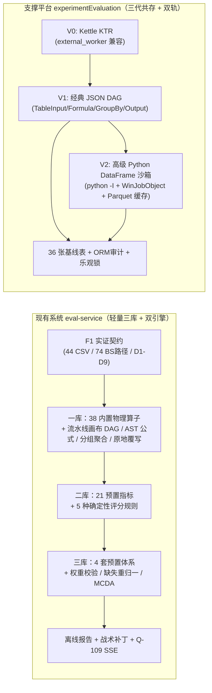

# 现有评估系统（`eval-service`）与支撑平台方案（`experimentEvaluation`）全量对比与优劣分析

> **对照基线**：
> - **现有系统（A）**：仓内 [`eval-service/`](../README.md)（F1 推演评估中台服务，Node.js + TypeScript + React/Vite + Python MCDA）。
> - **对比方案（B）**：支撑平台 `experimentEvaluation` 模块（来源文档：`d:\project\support-platform\backend\app\modules\experimentEvaluation\docs\评估模块源码深度解析.md`）。

---

## 1. 核心定位与技术架构总览

| 对比维度 | 现有系统（`eval-service`） | 对比方案（`experimentEvaluation`） |
| :--- | :--- | :--- |
| **核心定位** | 面向 F1 仿真推演（`GJ-11` / `BS`）的**轻量一体化实证评估中台与伴随研判工作台** | 面向多业务、多团队协同的**企业级双代通用仿真评估平台模块** |
| **后端技术栈** | Node.js（>=24，原生 `node:sqlite`）+ TypeScript（`tsx`）+ Python（`python/mcda_algorithms.py` 调用 `numpy`/`scipy`） | Python 后端（SQLAlchemy ORM + Pandas/NumPy/SciPy + `python-docx`）+ 达梦（Dameng）/SQLite 双方言 |
| **前端技术栈** | React + Vite，内聚 7 大工作台（`src/ui/App.tsx`） | Vue3 + Pinia + Axios + LogicFlow（DAG/思维导图）+ 自研纯 SVG 脑图（`MindmapCanvas.vue`） |
| **核心架构** | **三库分层（一库算子 → 二库指标 → 三库体系）+ 离线全量 / Q-109 在线伴随双引擎** | **三代演进架构**：V0 Kettle `.ktr` 外挂 → V1 JSON DAG 经典引擎 → V2 Python DataFrame 流式沙箱引擎 |
| **持久化模型** | `node:sqlite`（WAL + 外键）5 张核心表 + 本地 JSON 配置存储 | **36 张关系型基线表**（6 大子域：任务方案、经典指标算子、快照结果、审计账本、数据资产、高级建模缓存） |
| **数据输入适配** | 深度绑定 F1 实证契约：`EventExporter` 双 BOM CSV（44 类标准事件）+ `BS` 状态帧 JSONL/MQTT（`bs-diff.mjs`）+ `LabConsole/tools/metrics/metrics.py` | V1 强绑定关系库 `TARGET_SCHEMA`（SQL 宏/自适应探测）；V2 读 `EvalDataTemplate.sampleRows` / `DEFAULT_CSV_ROOT` / `DEFAULT_CMO_DB` |
| **自定义扩展** | **Pipeline Canvas Studio 可视化算法流水线编排**（6 类核心 DAG 节点：`data_input` / `inline_calc` / `group_agg` / `spatial` / `python_script` / `result_output`）+ `libformula` AST 公式引擎（20+ 函数）+ 流式复合多主键聚合引擎 + 声明式数据源直连（`source-extractor.ts`）+ **单一真相源双向自动同步（`deriveContractFromNodes`）** + 内置算子就地覆写（`override-store.ts`） | V1：4 类固定 JSON DAG（`TableInput` / `Formula` / `MemoryGroupBy` / `ResultOutput`）；V2：自由 Python DataFrame 脚本流水线 |
| **安全隔离哲学** | **语法级收缩 + 实证门控（Fail-Closed）**：无任意脚本执行入口，缺数只报 `unavailable` 绝不编造 | **进程级沙箱隔离**：静态 AST 白名单（17 根包、拦截 9 类危险调用）+ `python -I` + Windows `_WinJobObject` 15s 超时强杀 |
| **实时与智能闭环** | 原生支持 **Q-109 SSE 实时伴随监视**（300s 冷却、HITL 三态裁决）、NL-to-Metrics 草案、战术补丁 JSON 生成 | 无实时帧流/SSE 伴随监视，偏**离线批处理评估**与任务执行 |

---

## 2. 架构演进形态对比

---

## 3. 分维度深度对比

### 3.1 算子计算模型与自定义扩展能力

* **现有系统（`eval-service`）**
  * **领域语义内聚度高**：`src/operators/registry.ts` 注册 **38 个面向空海作战推演的内置物理算子**（时间域 `time.*` 9 个、效能域 `eff.*` 12 个含目标识别率等、态势域 `sit.*` 8 个基于 `@turf/*` 椭球几何与球面凸包、合规域 `comp.*` 5 个含 4D 走廊遵从判定、成本域 `cost.*` 4 个），内建真实引擎口径治理（例如剔除中文 `UnitType = "武器"` 避免导弹误算作平台战损、对 `WeaponEndgame.csv` 按 `WeaponID` 去重等）。
  * **低门槛双模自定义 + 原地覆写 + 流水线画布编排**：
    * **Pipeline Canvas Studio 可视化流水线编排**：支持 6 类 DAG 节点（`data_input` / `inline_calc` / `group_agg` / `spatial` / `python_script` / `result_output`），配合 `lineage-analyzer.ts` 保证全链路纯净输出（Pure Output），杜绝底表字段穿透污染。
    * **`libformula` AST 递归下降公式引擎**：支持优先级括号、四则运算与 20+ 内置函数（`IF`, `ROUND`, `DATEDIFF`, `CONCATENATE` 等），内建除零防御与空值安全降级。
    * **流式复合多主键跨行聚合引擎**：支持全表标量归约与复合主键分组，支持 11 种统计度量方法。
    * **单一真相源（Single Source of Truth）自动双向同步**：后端通过 `deriveContractFromNodes` 自动解析画布节点，反推 44 类 CSV 底表与 17+ 字段，自动持久化至 `operatorOverrideStore` 或 `customOperatorStore`；算子配置弹窗提供 `[⚡ 从画布节点自动同步]`，彻底消解“画布编排是一套、算子配置是另一套”的割裂。
    * `source_binding` 模式（`src/operators/source-extractor.ts`）直接绑定 CSV 表/列或 BS JSONL 路径并做过滤与聚合。
    * `override-store.ts` 支持对内置算子的元信息、全局默认参数（`defaultParams`）与 `f1FieldContract` 做就地覆写及一键恢复出厂。
  * **核心边界**：轻量级内存流式推演，不依赖复杂外部数据中间件或重量级数据库作业调度。

* **对比方案（`experimentEvaluation`）**
  * **双代并存的算子编排**：
    * **V1 经典引擎**（`operator_engine.py`）：通过 Kahn 拓扑排序编排 4 类受限算子，传递轻量 `TableRowStream(columns, rows, meta)`；`Formula` 节点将 `[字段]` 与类 Excel `IF(...)` 改写后在受限 `eval(expr, {"__builtins__": {}})` 中求值。
    * **V2 高级引擎**（`advanced_operator_engine.py` + `python_sandbox.py`）：支持自由编写 Python（`Pandas` / `NumPy` / `SciPy`）多步骤脚本流水线（`prev_output_df` → `output_df`），表达能力接近图灵完备。
  * **实体级宽表与增量缓存**：每个节点产出以实体主键对齐的 `DataFrame`，`deduce_parent_wide_table_schema` 能在未运行前静态推演 `node_{cid}__{col}` 的 `outer` 合并宽表；V2 并具备基于 `sha256(code_hash + upstream_hash)` 的 Parquet Snappy 步骤级 `0ms` 增量缓存（`eval_operator_step_cache`）与上游失效级联重算（`upstream_invalidated`）。

---

### 3.2 数据源对接、逆向工程与实证可信度

* **现有系统（`eval-service`）**
  * **统一实证目录与剖析**：内置 `sim-output-fields/schemas/f1-output-catalog.json`（F1 引擎 7 大通道、44 类事件、333 字段、`BS MQTT` 7 族 74 路径、8 条跨表 Join 配方与 `D1–D9` 实证偏差），前端可脱离具体 Run 查阅全量契约并反查依赖算子，也可对单局 Run 离线剖析 44 张 CSV 命中状况与前 50 行预览（`src/adapters/source-profiler.ts`）。
  * **严格实证门控（Fail-Closed）**：无论是内置算子、自定义直连抽取还是指标评分（`src/core/scoring-functions.ts`），遇到缺失表、缺失列、空值或非有限数均严格返回 `status: "unavailable"` 与 `missingDataReason`，同时附带可溯源帧号/行号证据 `evidenceRefs`；体系评估器（`src/systems/evaluator.ts`）按可用分支重归一权重并降级 `overallConfidence`（`high` / `medium` / `low`），**绝不伪造默认值完赛**。

* **对比方案（`experimentEvaluation`）**
  * **企业库逆向与导入能力成熟**：能查询平台 `run` 表与 `ALL_OBJECTS` 发现运行库 Schema，支持通过 SQLAlchemy `inspect` 逆向抽取表结构、字段注释、候选实体主键与跨方言采样行生成 `EvalDataTemplate`（`reverse_extract_data_template`），支持表格导入类型推断建表（`preview_data_import` / `create_data_import_job`）与模板绑定列校验（`bind_or_switch_template`）。
  * **实证严谨性存在明确漏洞（源码解析文档第 8 节已披露）**：
    1. V2 `preflight_contract_verification` 未在失败时硬阻断执行；
    2. 磁盘 CSV 与成本库缺失时，直接回退 `generate_benchmark_dataset()` **生成合成数据继续完赛**，生产环境下可能掩盖真实数据断流；
    3. 存在 `outputDf`（`python_sandbox.py` L542）与 `output_df`（`advanced_indicator_engine.py` L486）键名大小写不一致 bug，导致超过 50 个评估对象的叶子产出静默回退到 50 行截断快照；
    4. 大盘 `radar_data` 仍残留固定阵营静态占位结构；`unified_evaluation_task_data_source_plan.md` 规划的高级引擎直连 DB Schema 尚未合流（仍读 `DEFAULT_CSV_ROOT`/`DEFAULT_CMO_DB`）。

---

### 3.3 指标归一化与多准则决策（MCDA）内核

| 能力项 | 现有系统（`eval-service`） | 对比方案（`experimentEvaluation`） |
| :--- | :--- | :--- |
| **归一化极性/曲线** | 支持 5 种确定性规则：`linear`、`smaller_is_better`、`larger_is_better`、`step`、`boolean`（`src/core/scoring-functions.ts`） | V1 `IndicatorScoreService`（`SCORE_SCALE = 6`）支持 **4 种极性**（正向 `BENEFIT`、负向 `COST`、**适中型 `MODERATE`**、**区间型 `INTERVAL`**）与 **5 种算法**（`MAX_MIN`、**`INTERVAL_MAPPING`**、**`Z_SCORE`**、`CONSTANT`、**`COMPOSITE` 多段嵌套**） |
| **动态归一化阈值** | 由二库固定曲线参数或一库 `sweep` 参数敏感性扫描探索；暂缺跨全批样本自动动态定界 | V1 支持 `thresholdMode == "DYNAMIC"`，先在全样本对象集上统计 `min`/`max`/`mean`/`std` 作为归一化边界 |
| **V2 自动极性** | 需显式配置评分规则与方向，不做字段名猜测 | V2 无脚本汇聚按列名关键词（`Loss` / `Cost` / `Time`）自动判为负向，其余判正向（便捷但有误判风险） |
| **定权与决策算法** | 通过 `python/mcda_algorithms.py` 完整集成 **AHP（含 Saaty `CR < 0.10` 校验）+ Shannon 信息熵权法 + TOPSIS 多方案排序**，并支持双 Run 对比与单参数敏感性扫参 | V1 `ahp_service.py` 支持 1~10 阶 `RI_DICT` AHP 特征根求解与 `cr < 0.1` 校验；缺少熵权法、TOPSIS 排序与自动参数扫描 |

---

### 3.4 持久化、冷热存储与企业治理能力

* **现有系统（`eval-service`）**
  * **轻量单机底座**：`eval.db` 仅 5 张核心表即可支撑冷热数据、评测存档与实时卡片，自定义算子/覆写/指标均以人类可读 JSON 落盘（`data/custom-operators.json`、`data/operator-overrides.json`、`data/custom-indicators.json`），零运维部署成本。
  * **治理缺失项**：无多用户 RBAC 鉴权、无字段级历史审计表、无并发乐观锁、未在发起评估时冻结方案配置树快照（历史结果依赖 `eval_results` 自身摘要，若后续覆写算子，重跑同一体系会按新配置出数）、无 Parquet 列式大明细分页机制。

* **对比方案（`experimentEvaluation`）**
  * **企业级治理体系完备**：
    * **双层事务审计（`audit.py`）**：`AuditMixin` + `SoftDeleteMixin` 自动记录创建/修改/软删责任人；`Session.after_flush` 在同事务中写入 `eval_operation_log`，自动提取最多 12 个字段变更 diff（`detail_json` 上限 60,000 字符）。
    * **乐观锁防覆盖（`OptimisticLockMixin`）**：通过 `version_id_col` 拦截 `StaleDataError` 并统一翻译为业务码 `STALE_WRITE`。
    * **双层快照隔离**：建方案时复制冻结整棵指标树（`EvalSchemeIndicatorAnalysis`/`Node`），执行时再冻结输入快照（`EvalExecutionSnapshot`）。
    * **Parquet 冷热双存**：`eval_execution_node_data` 同时保存 `Parquet + Snappy` 压缩完整明细 BLOB（供抽屉按页切片查询）与前 50 行 JSON 热快照（毫秒首屏）。
    * **工程短板**：存在异步线程异常吞并导致 `active_execution_id` 死锁风险（`service.py` L5872），以及 `manifest.py`（`view`/`manage`/`run`）与 `advanced_api.py`（`edit`/`delete`）权限码不一致的问题。

---

### 3.5 实时研判、智能辅助与前端工作台交互

* **现有系统（`eval-service`）**
  * **实时 + AI + 报告闭环完整**：
    * **Q-109 在线伴随研判（`src/realtime/monitor.ts`）**：复用 `bs-diff.mjs` 实时推进/注帧与 SSE 推送，具备 300s 防骚扰冷却、minor→major 升级与人工 HITL 三态处置。
    * **决策交付闭环**：自动产出事实/推断/证据三栏隔离 Markdown 报告（`report-generator.ts`）、结构化战术补丁 JSON（`feedback-generator.ts`）与 NL-to-Metrics 体系草案生成（`intent-mapper.ts`）。
  * **7 大前端工作台**：驾驶舱（ECharts 雷达/权重/证据轴）、一库算子（含内联编辑/沙箱/对比/扫参/建模工作室）、二库指标工坊（曲线实时预览）、三库体系与 AI（NL 草案 + AHP/熵权/TOPSIS）、仿真输出规范、单局数据与 `eval.db`、实时 Q-109。

* **对比方案（`experimentEvaluation`）**
  * **可视化画布交互更丰富**：
    * V1 使用 LogicFlow 实现 DAG 节点连线与 `StepPreviewManager` 单步 30 分钟 TTL / 1000 行调试预览；
    * V2 `MindmapCanvas.vue` 采用自研 SVG 三次贝塞尔曲线脑图，支持方向键/快捷键编辑、从右侧算子库**直接拖拽挂载（Drag & Drop）**到叶子节点并实时触发父节点宽表推演，点击结果树节点可通过 `NodeDataDrawer.vue` 逐层下钻 Parquet 分页明细，并支持一键导出 `.docx` Word 评估报告（`report_service.py`）。
  * **能力缺口**：无在线实时推演监听通道、无 NL-to-Metrics 与战术反哺补丁输出。

---

## 四、 双方核心优劣势对照总结

### 1. 现有系统（`eval-service`）

* **突出优势**
  1. **强实证、零幻觉（Fail-Closed）**：深度锚定 `GJ-11` CSV 与 `BS` 帧真实结构，每条分值均可追溯行号/帧号证据，缺数只报 `unavailable`，避免静默出错。
  2. **实时伴随与决策反哺闭环完整**：独有 Q-109 SSE 在线监视、NL 体系生成、三栏证据报告、战术补丁 JSON 与 AHP/熵权/TOPSIS + 扫参对比工具。
  3. **轻量化与安全性高**：零 `eval` 公式引擎 + 声明式数据源抽取兼顾交互灵活与执行安全；单进程 Node + SQLite 开箱即用，对主仿真仓零侵入。
* **主要短板**
  1. **缺少实体/对象明细级宽表计算能力**：当前仅产出局级/阵营级标量，难以直接支持“上百架平台逐一计算明细、逐层 `Outer Join` 与大数据抽屉分页”。
  2. **无通用复杂科学计算脚本沙箱**：声明式公式和聚合难以表达跨帧滑动窗口、轨迹聚类或自定义 Python 算法模型。
  3. **企业协同治理薄弱**：缺乏 RBAC 鉴权、字段级审计日志、乐观锁、配置快照冻结与 Word（`.docx`）报告导出。

### 2. 支撑平台方案（`experimentEvaluation`）

* **突出优势**
  1. **企业级治理与双数据库底座坚实**：36 张基线表、达梦/SQLite 适配、同事务变更审计、乐观锁与方案级配置快照冻结，天然适配多人多角色生产环境。
  2. **V2 面向海量实体明细的流式沙箱成熟**：AST + `python -I` + `_WinJobObject` 安全强隔离、SHA-256 步骤 Parquet 缓存、`node_{cid}__{col}` 宽表推演及“50 行热快照 + Parquet 冷分页”兼顾吞吐与响应速度。
  3. **归一化数学形态与画布编排强**：涵盖适中型/区间型/Z-Score/复合分段规则与动态阈值；SVG 脑图拖拽绑定算子体验直观，并能导出 `.docx` 报告。
* **主要短板（结合源码解析文档）**
  1. **历史包袱重、方案割裂**：Kettle + V1 JSON DAG + V2 流式三代并存，规划中的统一数据源连接方案尚未落地，V1 仍用 `eval` 且存在异步线程异常吞并致死锁风险。
  2. **实证门控不严与隐蔽实现缺陷**：缺数回退合成数据完赛、契约预检未硬阻断、雷达图存在静态占位数据、存在 `outputDf`/`output_df` 大小写截断 bug 以及权限编码未对齐。
  3. **缺乏实时监视与仿真域口径治理底座**：仅覆盖离线任务态评估，缺少实时帧监视与类似 `D1–D9` 的底层字段实证偏差知识库。

---

## 五、 后续融合演进建议

1. **`eval-service` 建议优先吸收对侧的 4 项能力**：
   * **方案执行期快照冻结**：调用 `POST /api/evaluate` 时，将当时生效的一/二/三库定义与 `operator-overrides` 一并冻结写入评估结果快照，保障历史评测严格可复现。
   * **扩充 `scoring-functions.ts` 归一化形态**：在现有 5 类规则基础上增补 `moderate`（适中型）与 `interval`（区间型）曲线及可选跨局动态阈值模式。
   * **引入可选实体级明细（`entityRows`）输出**：允许算子除返回主标量外附带实体明细表，支撑驾驶舱下钻查看单平台/单武器维度表现。
   * **文件指纹缓存与 `.docx` 导出**：为耗时较长的 CSV/JSONL 大样本扫描与扫参引入输入文件指纹缓存，并按交付场景补齐 Word 报告导出。

2. **支撑平台（`experimentEvaluation`）建议优先借鉴本系统的 3 项实践**：
   * **严格推行实证门控（Fail-Closed）与输出契约目录**：取消生产态缺失 CSV 自动回落合成数据的逻辑，显式上报 `unavailable` 与缺失原因，并沉淀类似 `f1-output-catalog` 的字段语义与口径差异字典。
   * **加速收敛 V1/V2，淘汰 V1 `eval` 公式节点**：用零 `eval` 安全表达式解析器 + 声明式表列抽取替代 V1 简单 SQL/Formula 节点，仅将高复杂度科学计算交由 V2 `python -I` 沙箱处理。
   * **补齐决策寻优与敏感性分析工具链**：引入熵权法、TOPSIS 排序及单参数敏感性扫描，使评估平台从“纯离线打分”升级为“多方案决策寻优”。
