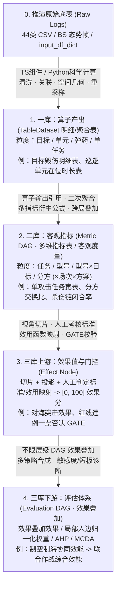

# F1 推演评估中台 V4 全链路 DAG 架构改造总体设计方案

> **文档状态**：基线设计方案（V4 Architecture Baseline）  
> **适用范围**：`eval-service/` 独立评估中台  
> **核心理念**：表格驱动（`TableDataset`）、三层强隔离 DAG 画布、效果独立叠加、实证穿透溯源、Fail-Closed 零造假

---

## 第 1 章：背景与现状诊断

### 1.1 现有系统的可保留核心资产

经过对当前 `eval-service/` 代码库（[src/core/types.ts](file:///d:/project/F1-AI-demo-lua-structure-tools/eval-service/src/core/types.ts)、[src/systems/evaluator.ts](file:///d:/project/F1-AI-demo-lua-structure-tools/eval-service/src/systems/evaluator.ts)、[src/indicators/store.ts](file:///d:/project/F1-AI-demo-lua-structure-tools/eval-service/src/indicators/store.ts)、[src/operators/pipeline-engine.ts](file:///d:/project/F1-AI-demo-lua-structure-tools/eval-service/src/operators/pipeline-engine.ts)）的全面审查，以下工程资产具备坚实基础，改造中应**保留并演进**，而非推倒重来：

1. **三库评估聚合与红线门控引擎（`src/systems/evaluator.ts`）**：
   - 已实现多策略聚合（加权和 `weighted_sum`、加权积 `weighted_product`、几何平均 `geometric_mean`、木桶短板 `maximin`、自定义公式 `formula`）、缺数自动重归一（`skip_renormalize`）与 AHP 一致性比率校验。
   - 已实现双轨安全红线门控审计（`GATE`：`hard` 一票否决封顶 $\le 39$ / `soft` 告警 `WARNING`）。
2. **二库切片归约与效用映射种子（`src/indicators/store.ts`）**：
   - `IndicatorDefinition` 与 `extractSingleSourceValue` 已初步沉淀 `targetField`（选列）、`filterCriteria`（按条件切片行）、`reduce`（跨行归约）、`composeFormula`（多算子复合 AST）及 `ScoringRule`（线性/极大型/极小型/阶梯/区间映射）。
3. **Fail-Closed 实证门控与多源数据适配器**：
   - 双 UTF-8 BOM 清洗、44 类 CSV 底表与 BS 态势帧接入、SQLite 持久化存储及 `unavailable` 显式缺失理由传播机制完整可用。
4. **DAG 画布前端底座（`src/ui/components/pipeline-canvas/`）**：
   - 已具备节点编排、连线防水平退化（`CanvasConnectionLines.tsx`）、血缘分析（`lineage-analyzer.ts`）、属性抽屉与表格预览等交互骨架。

### 1.2 当前系统的 4 个结构性瓶颈

尽管骨架清晰，但在面对真实军事仿真评估（如 [metrics_calculation_guide.html](file:///d:/project/beifen/metrics_calculation_guide.html) 中的 8 大类复杂评估与多阵营/多场次对抗分析）时，系统暴露出 4 个根本性架构限制：

1. **算子契约仍是“标量本位”，二维表沦为二等公民**：
   - 在 `src/core/types.ts` 中，`MetricAtomResult` 的一等输出为 `value: number | boolean | null`，二维表 `outputDataset` 仅是嵌套在可选属性 `details` 中的附属品。
   - 算子强行在单一步骤内过早坍缩成单个数字，导致无法在算子间传递明细表，也无法在前端点击节点做目标级/单元级钻取溯源。
2. **一库 40 项实证算子存在“占位空壳”且粒度混杂**：
   - 在 [src/operators/v2/new-operators.ts](file:///d:/project/F1-AI-demo-lua-structure-tools/eval-service/src/operators/v2/new-operators.ts) 中，大量算子（如 `strike.damage_simulation`、`strike.single_mission_metrics`、`strike.composite_mission_metrics`）的 `evaluate(ctx)` 仅校验所需 CSV 表是否存在，随后硬编码返回 `value: 1.0`，并未执行真实物理与统计计算，也未吐出二维明细表。
   - 同时，不同计算粒度（目标级明细 ➔ 单任务聚合 ➔ 分方综合汇总）被平铺在同一层级，未形成流式 DAG 组合。
3. **三套计算执行内核割裂**：
   - TS 硬编码算子（`OPERATORS_V2`）、TS 流水线引擎（`pipeline-engine.ts` 中的行内公式与分组聚合）、以及 Python 脚本节点（`python_script`）尚未在统一的 `TableDataset` 进出契约和常驻运行期下打通。
4. **缺乏“多维指标表视图”与“自由层级效果叠加”能力**：
   - 二库（[src/indicators/catalog.json](file:///d:/project/F1-AI-demo-lua-structure-tools/eval-service/src/indicators/catalog.json)）仅面向单值标量；三库受限于静态目录树结构，不支持**指标基于指标二次派生**、**效果节点独立建立与复用**以及**效果叠加效果的任意深度 DAG**。

---

## 第 2 章：顶层概念体系与军事业务映射

### 2.1 四层数据形态演进（维度漏斗模型）

真实推演评估的数据流动是一个从离散原始日志逐级清洗、聚合、切片到价值裁决的“维度收敛漏斗”：



### 2.2 军事运筹分层与工程架构的正交对齐

军事领域经典的**“性能 ➔ 效果 ➔ 效能”**三层分类与五大专业域，在本系统的新三库架构中**完全兼容且正交对齐**：

| 军事业务概念 | 典型实例 | 在 V4 工程架构中的落点 | 核心职责 |
| :--- | :--- | :--- | :--- |
| **仿真底层输出** | 位置坐标点、发射事件、毁伤记录 | **底表层**（CSV / BS JSONL） | 提供客观、不可篡改的仿真原始事实 |
| **性能指标（MOP）** | 雷达探测距离、弹药命中率、最大航速、在位时长 | **一库算子（明细/汇总表）➔ 二库基础指标** | 经物理清洗、空间判定和统计后形成的客观装备/单元性能度量 |
| **效果指标（MOE）** | 目标发现率、毁伤达成率、战损生存率 | **二库指标 DAG（客观计算态）** | 基于基础表/基础指标二次聚合或复合计算出的环节客观比率/物理量 |
| **效能指标（MOFE）** | 任务综合达成率、敌我交换比、体系杀伤链闭合率 | **二库高级派生指标**（客观数值态）+ **三库效果节点/体系总效**（价值评判态） | 客观交换比在二库计算；结合指挥意图打分与权重的综合任务裁决在三库完成 |
| **五大专业能力域** | 火力打击、侦察预警、生存机动、指挥控制、体系协同 | **二库指标 & 三库效果组件库的业务分类标签（Domain Tag）** | 用于资产分类检索、画布分组与能力短板雷达图聚合 |

### 2.3 核心名词消歧：“效果指标” vs “评估效果节点”

为杜绝业务讨论与代码建模中的一词多义，系统严格约定如下语义边界：

- **二库中的“客观指标（Metric）”**：不论属于 `MOP`、`MOE` 还是 `MOFE` 标签，只要还在二库，就**只表达客观物理事实或统计度量**（带量纲或原始比率，如 `68.5%`、`142 秒`、`2.5:1`），**严禁出现主观权重或百分制打分**。
- **三库中的“效果（Effect）”**：是**价值判断与合成单元**。它接收客观指标（或下级效果），叠加**人工考核标准、效用映射函数（`[0, 100]`）与组合权重策略**，输出可层层叠加的无量纲效果分或安全门控态（`PASS / WARNING / DISQUALIFIED`）。

---

## 第 3 章：核心架构设计原则（六大支柱）

### 3.1 混合执行内核与统一 `TableDataset`（Tidy Data）契约

1. **TS 原生组件 + 常驻 Python Worker 双核驱动**：
   - **TS 原生引擎**保留并强化：数据源提取（`data_input`）、LibFormula AST 行内公式（`inline_calc`）、跨行分组聚合（`group_agg`）、Turf 空间基础判定（`spatial`）。保证高频轻量运算毫秒级响应。
   - **常驻 Python Worker 进程池**：通过 stdin/stdout JSON-RPC 常驻内存预加载 `pandas`、`numpy`、`shapely` 等白名单科学计算库（严禁 `eval/exec/open`），彻底消除每次执行冷启动耗时，负责复杂多表 Join、5s 时窗重采样、多边形面积并集与高阶统计。
2. **统一 `TableDataset` 进出契约（Tidy Data 整洁二维表）**：
   - 所有算子与指标计算节点统一遵循“**`TableDataset` 进、`TableDataset` 出**”标准契约，彻底废除旧版“算子强制返回单值标量”的设计。
   - **多维表（2D/3D）极简化处理**：不引入异构的 3D 张量存储模型；单局产出的标准二维表（如 `分方 × 度量列` 或 `型号 × 目标 × 度量列`）在进入多场次（蒙特卡洛）或多方案对比时，由引擎自动注入 `planId`、`runId`、`iteration` 维度列，依然保持统一 `TableDataset` 结构；前端表格/透视组件负责按任意维度列动态展开为交叉透视表（Pivot）或三维对比图。

### 3.2 三层统一 DAG 画布底座与数据类型强隔离

前端将现有 `src/ui/components/pipeline-canvas/` 抽离为三库通用的 DAG 画布组件（支持自由节点拖拽、缩略图/缩放平移、子图折叠/展开、防退化贝塞尔连线、节点状态徽章及辅助侧边大纲），但**严格隔离三条画布连线上流淌的数据类型**，防止架构腐化：

| 画布空间 | 对应库 | 连线流淌数据类型 | 允许的节点操作 | 禁止越界行为 |
| :--- | :--- | :--- | :--- | :--- |
| **算子画布** | **一库（算子库）** | `TableDataset`（原始底表 / 实体明细表 / 中间汇总表） | 数据源输入、清洗过滤、行内公式、空间几何、跨行聚合、Python 脚本 | 禁止硬编码主观考核及格线、禁止权重打分 |
| **指标画布** | **二库（指标库）** | `MetricDataset / MetricValue`（客观业务指标表或物理度量值） | 引用算子输出表、二次聚合、多指标公式衍生（不限层级）、维度切片 | 禁止写入权重、禁止效用百分制映射 |
| **体系画布** | **三库（评估体系）** | `EffectScore [0~100]` + `GateStatus`（无量纲效果分与门控态） | 指标接入与效用转换、**独立/内置效果节点**、效果叠加效果（不限层级）、红线门控 | 禁止直接写原始 CSV 行级过滤脚本 |

### 3.3 人工判定标准收口与“行级参数透传”机制

针对“人工判定标准统一放在效果值层”与“先判定、后聚合”业务需求（如 `1.1.2 单攻击任务完成比` 需先按目标毁伤阈值 `0.5` 判定每目标是否达标，再按任务求均）之间的矛盾，采用**参数端口透传架构**：

- **效用与等级评判（好坏打分）**：完全收口于**效果值层**（例如“完成率 `66.7%` 对应效用分 `72 分`”）。
- **行级物理判定门限（如毁伤 $\ge 0.5$、巡逻在阵位 $\ge 1800$ 秒、损失容忍 $\le 1$）**：绝不硬编码在算子或指标脚本中，而是声明为算子/指标节点的**运行时参数端口（`runtimeParams`）**，提供安全默认兜底值，并在效果值层或评估体系方案配置时显式注入并向下游透传覆盖。

### 3.4 独立效果库（Effect Store）与无限层级 DAG 合成规则

1. **独立沉淀 + 画布原地创建双模式**：
   - 建立一等公民 **效果组件库（Effect Store）**，内置军事领域标准效果模板（如“对海突击任务效果”、“防空拦截效果”、“红线安全门控”），同时支持将体系画布中调试好的效果节点一键“另存为复用效果”。
   - 在体系画布中，既可直接拖入库内已有效果节点，也支持原地新建临时/私有效果节点并连线，避免跨页面反复跳转。
2. **不限层级 DAG 运筹约束**：
   - **强制 Kahn 判环**：任何效果节点不得构成有向环依赖（`Effect A -> Effect B -> Effect A` 直接在校验期拦截）。
   - **局部入边权重归一化**：在允许一个指标同时支撑多个效果的 DAG 网络中，废弃“全树叶子绝对权重和为 1”的树形假设，改为**每个效果节点自身所有入边的权重之和严格等于 $1.0000 \pm 10^{-4}$**（支持 AHP 成对比较矩阵生成权重，保证 $CR < 0.10$）。
   - **辅助视图双联动**：由于无限层级自由画布在大型体系下易出现视觉交叉，画布右侧配套“大纲层级树 / 权重矩阵表”辅助面板，点击列表项定位高亮画布节点，修改权重实时驱动画布重算。

### 3.5 节点级内容寻址缓存与增量重算

为保障用户在体系画布拖动权重、调整人工判定标准时实现**毫秒级实时刷新**而不触发底层算子重复扫描百万行轨迹 CSV：

- 引入全链路节点内容寻址缓存键：
  $$\text{CacheKey} = \text{SHA256}(\text{runId},\; \text{nodeId},\; \text{nodeDefHash},\; \text{runtimeParamsHash},\; \text{upstreamCacheKeys})$$
- 仅当某个节点自身配置、透传参数或任意上游输入哈希发生变化时才失效重算；调整三库权重与效用曲线时，一库与二库节点 100% 命中缓存直出结果。

### 3.6 全链路穿透下钻与 Fail-Closed 断链高亮

- **实证下钻链路**：`评估总览得分卡 ➔ 体系画布变红/低分效果节点 ➔ 二库指标画布对应客观指标/透视表 ➔ 一库算子画布对应节点 ➔ 实体明细证据行 / 缺失底表提示`。
- **Fail-Closed 传播规则**：任意节点若缺少必需 CSV 表、目标列为空或除零无定义，状态严格标记为 `unavailable` 并附带 `missingDataReason`；向上传播至效果节点时，按该节点的 `missingPolicy`（默认 `skip_renormalize` 跳过并重归一有效入边权重，或 `fail` 级联失效）处理，绝不填充伪造默认分值。

---

## 第 4 章：核心数据契约草案（TypeScript）

以下接口将作为后续 Phase 1 改造 `src/core/types.ts` 的直接设计蓝本（保留现有兼容字段，增量扩展核心模型）：

```typescript
/** 统一数据层契约：支持单局二维表及注入 planId/runId 后的多局整洁二维表 */
export interface TableDataset {
  id?: string;
  columns: DatasetColumn[];
  rows: Array<Record<string, unknown>>;
  totalRows?: number;
  /** 可选维度元信息：标识主键列（实体/任务/分方）与度量列，供前端透视渲染 */
  dimensionKeys?: string[];
  measureKeys?: string[];
}

/** 节点运行时参数声明（支持从三库效果层向一库/二库透传行级阈值） */
export interface ParameterPortSpec {
  key: string;
  label: string;
  dataType: 'number' | 'string' | 'boolean' | 'json';
  defaultValue: unknown;
  description?: string;
}

/** 通用 DAG 图定义：一库算子与二库指标共享拓扑骨架，通过 graphKind 强隔离 */
export type DagGraphKind = 'operator' | 'metric' | 'system';

export interface DagEdge {
  id: string;
  sourceNodeId: string;
  targetNodeId: string;
  /** 仅 system 画布有效：指向目标效果节点的局部权重（入边之和=1.0） */
  weight?: number;
  /** 可选端口绑定：将上游输出列或结果绑定到目标节点变量别名 */
  targetAlias?: string;
}

export interface DagNodeBase {
  id: string;
  kind: string;
  label: string;
  position: { x: number; y: number };
  collapsed?: boolean;
  /** 节点声明的可外部覆盖参数端口 */
  parameterPorts?: ParameterPortSpec[];
  /** 当前节点实参或参数透传覆盖 */
  params?: Record<string, unknown>;
}

/** 一库算子节点输出：强契约为 TableDataset + Fail-Closed 证据状态 */
export interface OperatorNodeExecutionResult {
  nodeId: string;
  status: 'valid' | 'degraded' | 'unavailable';
  dataset?: TableDataset;
  evidenceRefs: EvidenceRef[];
  missingDataReason?: string;
  cacheKey: string;
  latencyMs: number;
}

/** 二库指标定义：支持引用算子表、聚合切片或引用其他指标二次派生（无权重、无主观打分） */
export interface MetricNodeConfig {
  metricId: string;
  name: string;
  militaryLevel: 'MOP' | 'MOE' | 'MOFE';
  domainTag: 'firepower' | 'isr' | 'survivability' | 'c2' | 'synergy' | 'cost';
  mode: 'from_operator' | 'from_metric_agg' | 'from_metric_formula';
  /** 从上游 TableDataset 提取与切片：支持过滤条件、分组聚合或投影选列 */
  sourceRef?: string; // operatorId 或 upstream metricId
  filterCriteria?: Record<string, unknown>;
  groupBy?: string[];
  targetField?: string;
  reduce?: IndicatorReduceMethod;
  /** 多指标复合计算表达式（走 LibFormula 安全 AST） */
  formulaExpression?: string;
  unit?: string;
}

/** 三库独立效果定义：效果组件库核心模型，支持人工判定标准、效用映射与无限层级叠加 */
export interface EffectDefinition {
  effectId: string;
  name: string;
  description?: string;
  isBuiltin?: boolean;
  domainTag?: MetricNodeConfig['domainTag'];
  /** 角色：普通效果合成 / 安全红线门控 */
  role: 'effect' | 'gate';
  gateMode?: 'hard' | 'soft';
  /** 接入二库指标时的降维切片与效用转换规则（人工完成标准在此生效） */
  metricBinding?: {
    metricId: string;
    sliceFilter?: Record<string, unknown>;
    targetField?: string;
    reduce?: IndicatorReduceMethod;
    /** 透传给上游算子/指标的参数覆盖（如毁伤达标线 0.5、在阵位最低秒数 1800） */
    paramOverrides?: Record<string, unknown>;
    scoringRule: ScoringRule;
    alarmThreshold?: AlarmThreshold;
  };
  /** 合成策略：当由多个子效果/指标入边叠加时生效 */
  aggregation: {
    strategy: AggregationStrategy;
    missingPolicy: NodeMissingPolicy;
    customFormula?: string;
    ahpMatrix?: number[][];
    ahpCr?: number;
  };
}

/** 三库评估体系 DAG（替代旧版固定树 Root，支持无限层级自由有向无环图） */
export interface EvaluationSystemDag {
  systemId: string;
  name: string;
  version: string;
  description?: string;
  /** 画布节点：可以是引用二库的 MetricProxy，也可以是内置/独立/私有的 EffectNode */
  nodes: Array<DagNodeBase & { refId?: string; inlineEffect?: EffectDefinition }>;
  edges: DagEdge[];
  /** 指定作为体系最终综合效能输出的终态效果节点 ID */
  terminalEffectNodeId: string;
  /** 全局方案级默认参数（如 targetSide、enemySide、WRA 规则等） */
  globalParams?: Record<string, unknown>;
}

/** 节点级内容寻址缓存项 */
export interface NodeExecutionCacheEntry {
  cacheKey: string;
  graphKind: DagGraphKind;
  nodeId: string;
  status: 'valid' | 'degraded' | 'unavailable';
  payload: TableDataset | number | boolean | null;
  missingDataReason?: string;
  computedAt: string;
}
```

---

## 第 5 章：五阶段改造实施路线图（Phase 1 ~ Phase 5）

整个改造严格采用**双轨渐进迁移策略**，每个 Phase 结束均需保证现有 50 项（及新增）自动化测试与前端生产构建全绿通过。

| 阶段 | 核心目标 | 重点改动范围与交付物 | 阶段验收标准 |
| :--- | :--- | :--- | :--- |
| **Phase 1**<br>统一契约与 DAG 内核 | 建立 V4 数据底座与混合调度内核，不影响现有旧 UI 运行 | 1. 扩展 `src/core/types.ts` 契约<br>2. 新增通用 DAG 拓扑排序、Kahn 判环、参数向下透传与 `CacheKey` 增量缓存引擎<br>3. 搭建常驻 Python Worker JSON-RPC 沙箱池（预加载 `pandas/numpy/shapely` 及 AST 安全校验） | 1. 新增 DAG 调度、参数透传、缓存命中与 Python Worker 单元测试全过<br>2. 原有全量测试与 `build:ui` 100% 通过 |
| **Phase 2**<br>一库算子实证化重构 | 彻底清除 `value: 1.0` 空壳，让一库算子真实做到“表进表出” | 1. 重构 `src/operators/v2/new-operators.ts` 40 项算子及 `registry.ts`，按“基础明细算子 ➔ 聚合算子”拆解入库<br>2. 接通 TS 组件 + Python Worker 混合执行，行级阈值抽离为 `ParameterPortSpec`<br>3. 升级一库前端表格预览与明细列 Schema 展示 | 1. 一库任意算子节点运行输出真实 `TableDataset` 二维表<br>2. 缺表/缺列严格返回 `unavailable`，全量测试通过 |
| **Phase 3**<br>通用画布 + 二库指标 DAG | 抽离共用画布底座，实现二库指标自由层级派生与多维透视预览 | 1. 将 `pipeline-canvas/` 抽离为三库复用 DAG 画布组件（含子图折叠、大纲联动）<br>2. 升级 `src/indicators/store.ts` 支持引用算子表、二次聚合及指标衍生指标，强校验无主观权重<br>3. 重构 `IndicatorStudioView.tsx` 为“指标 DAG 画布为主 + 二维/透视表预览为辅” | 1. 可在二库画布完成“算子表 ➔ 一级指标 ➔ 二次复合指标”不限层级编排<br>2. 支持按分方/型号动态切片透视预览 |
| **Phase 4**<br>独立效果库 + 三库体系 DAG | 落地“效果独立建立 / 复用 / 效果叠效果 / 局部权重”的评估体系画布 | 1. 新增 `EffectStore` 及内置军事效果/红线门控模板库<br>2. 升级 `src/systems/evaluator.ts` 为支持无限层级 DAG、入边权重局部归一化（$=1.0$）、AHP 矩阵与门控审计的新引擎<br>3. 重构 `SystemDesignerView.tsx` 为“体系 DAG 画布 + 权重矩阵大纲双向联动” | 1. 调整体系权重或效果阈值时，一/二库 100% 命中缓存实现毫秒级刷分<br>2. 形成完整体系评估报告与红线裁决 |
| **Phase 5**<br>全链路穿透下钻与收口验收 | 打通三层画布溯源与多局对比，完成终极场景实测验收 | 1. 打通 `总览 ➔ 体系效果 ➔ 指标节点 ➔ 算子明细行` 一键下钻与断链高亮<br>2. 支持多场次/多方案自动注入 `runId/planId` 对比视图<br>3. 完成第 6 章终极验收里程碑 | `npm --prefix eval-service test` 与 `npm --prefix eval-service run build:ui` 全绿，真实场景跑通 |

---

## 第 6 章：终极验收里程碑（Milestone Target）

系统 V4 改造全部完成后，必须通过以下两项真实端到端业务大考作为最终收口验收标准：

### 里程碑 1：搭建完整 `metrics_calculation_guide.html` 评估体系
严格对照 [metrics_calculation_guide.html](file:///d:/project/beifen/metrics_calculation_guide.html) 中梳理的全部 **8 大类指标口径**，在新 V4 评估中台中从零搭建一套完整、可运行、可下钻的示范评估体系，全量覆盖：
1. **1 任务效果**：攻击任务（毁伤仿真明细 ➔ 单攻击任务 ➔ 多攻击综合）、巡逻任务（多边形在阵位判定 ➔ 单元级 ➔ 任务级）、支援任务；
2. **2 装备效能**：探测效能、火控效能（识别与 4 时间点杀伤链闭环）、武器效能（平台发射、弹药按型号/型号×目标穿透、打击范围）；
3. **3 成本效益**：分方消耗战损、战损交换比、按型号飞机损失、任务消耗战损、平台毁伤概率；
4. **4 侦察预警**：侦察范围、目标发现率、识别用时、防空预警提前时间、侦察覆盖面积与效率；
5. **5 指挥控制体系效能**：战场态势完整度；
6. **6 电子干扰电子进攻体系效能**：目标持续受扰时间、`jammed/unjammed` 积分与短波通信网台干扰压制率；
7. **7 防空反导体系效能**：防空雷达探测区域、拦截区域（单元/型号级）、体系综合拦截概率；
8. **8 自定义衍生指标**：通过指标画布二次公式派生验证。

要求实现：**算子 DAG（原始表 ➔ 明细表/汇总表） ➔ 指标 DAG（8 大类客观指标及衍生） ➔ 独立效果节点与多层级评估体系 DAG（含人工完成标准、权重与红线门控）** 全链路闭环运行。

### 里程碑 2：接入 55 所台海场景实景数据开展全量评估
直接选用已在数据源配置（[data/simulation-data-sources.json](file:///d:/project/F1-AI-demo-lua-structure-tools/eval-service/data/simulation-data-sources.json)）中登记的 `55th_taihai_csv` 数据集：
- **数据源路径**：`J:\55所\想定导出\EventExport_CSV`（55 所台海场景大型实景推演全量事件导出，包含红/蓝/绿/俄多阵营）；
- **核心验证项**：
  1. 在新体系中真实加载 55 所全量 CSV（自动处理双 UTF-8 BOM、武器的 `UnitType="武器"` 过滤、`WeaponEndgame` 去重等真实数据特异性）；
  2. 分阵营（红方/蓝方等）输出完整的二维明细表、聚合指标透视表、各项效果得分及综合评估报告；
  3. 针对缺失底表或空表项（若有），严格验证 Fail-Closed `unavailable` 标记、入边重归一逻辑及从“评估总览 ➔ 体系效果 ➔ 指标节点 ➔ 算子明细行”的端到端穿透溯源能力。
